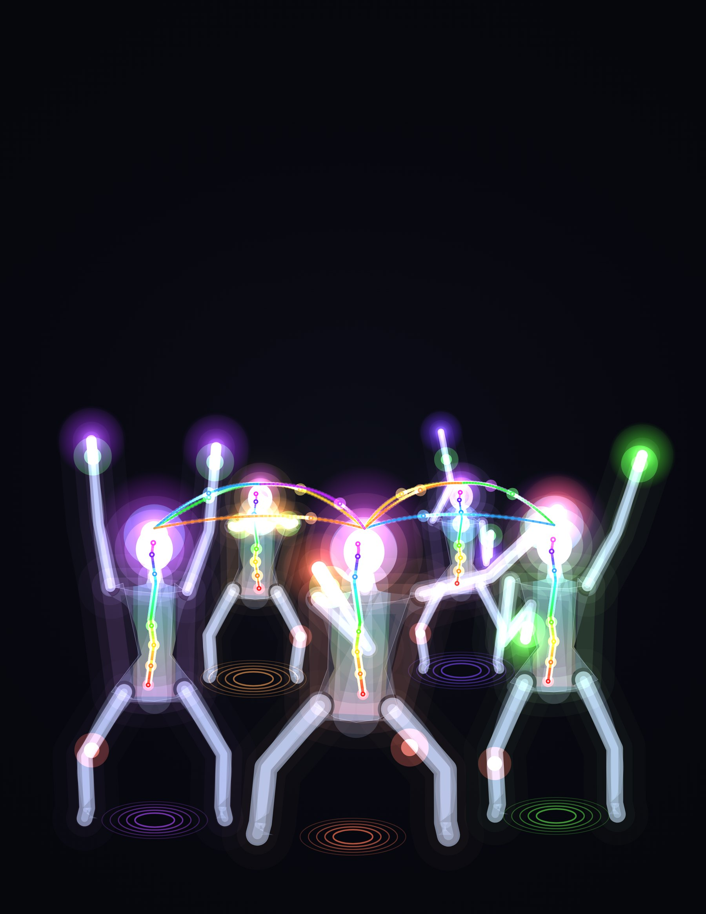
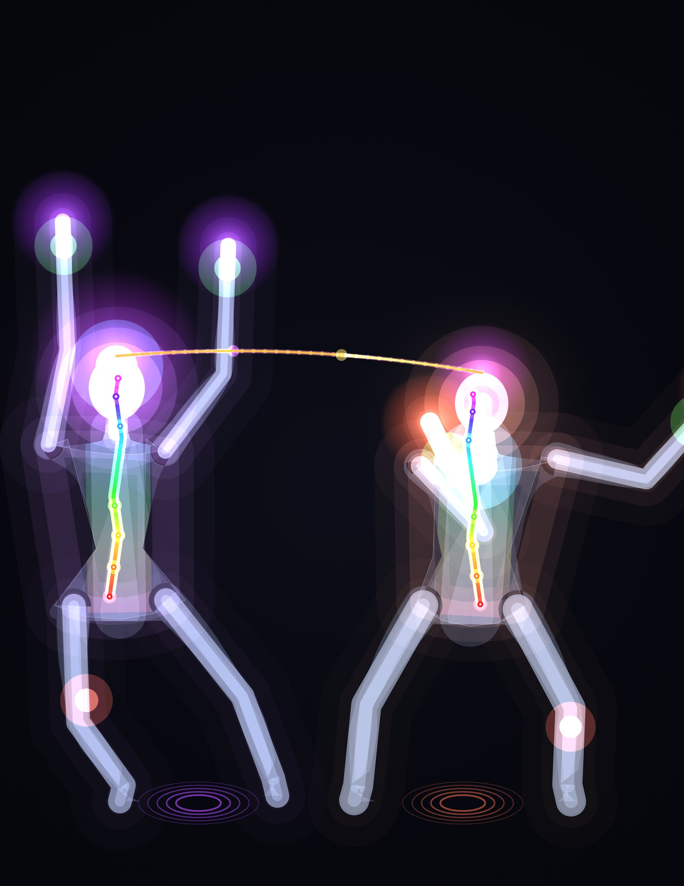
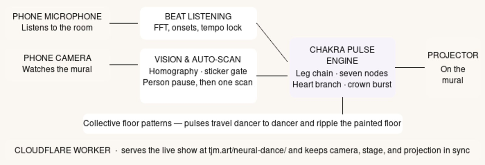
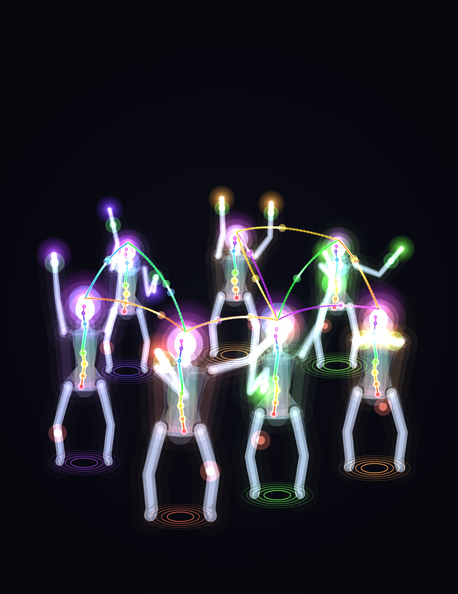
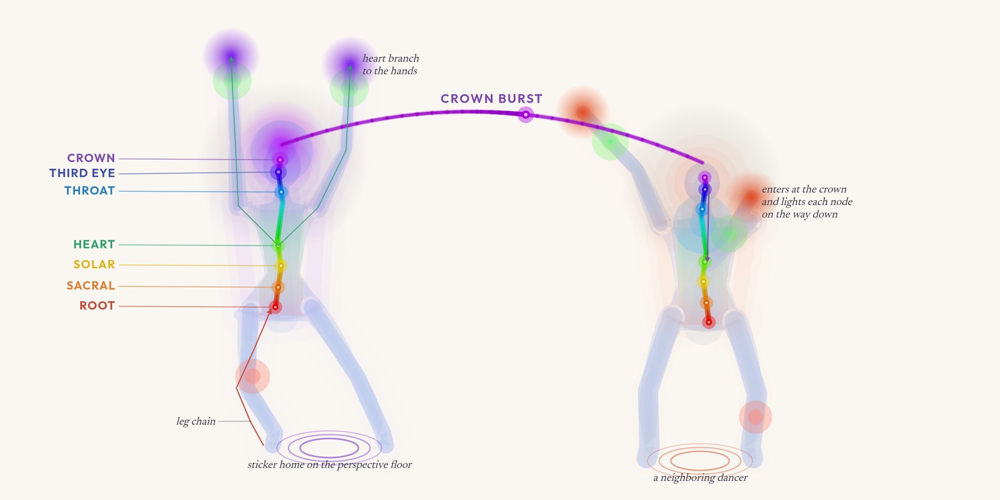
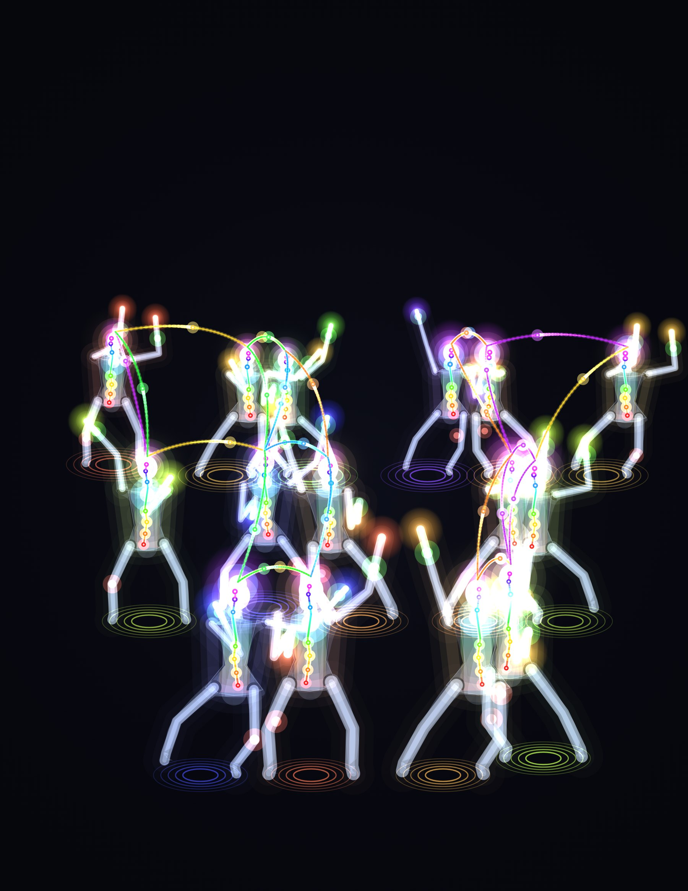
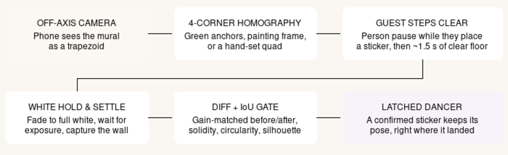
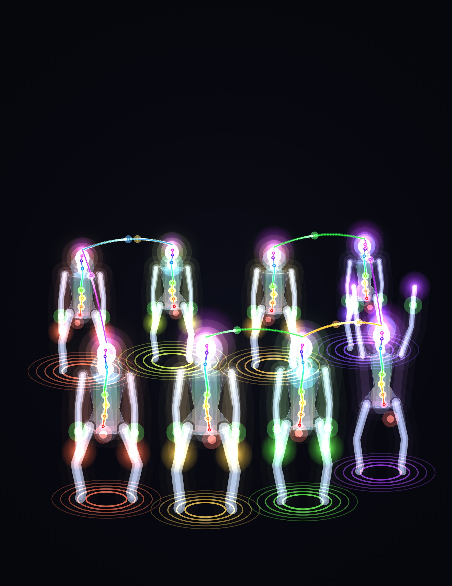
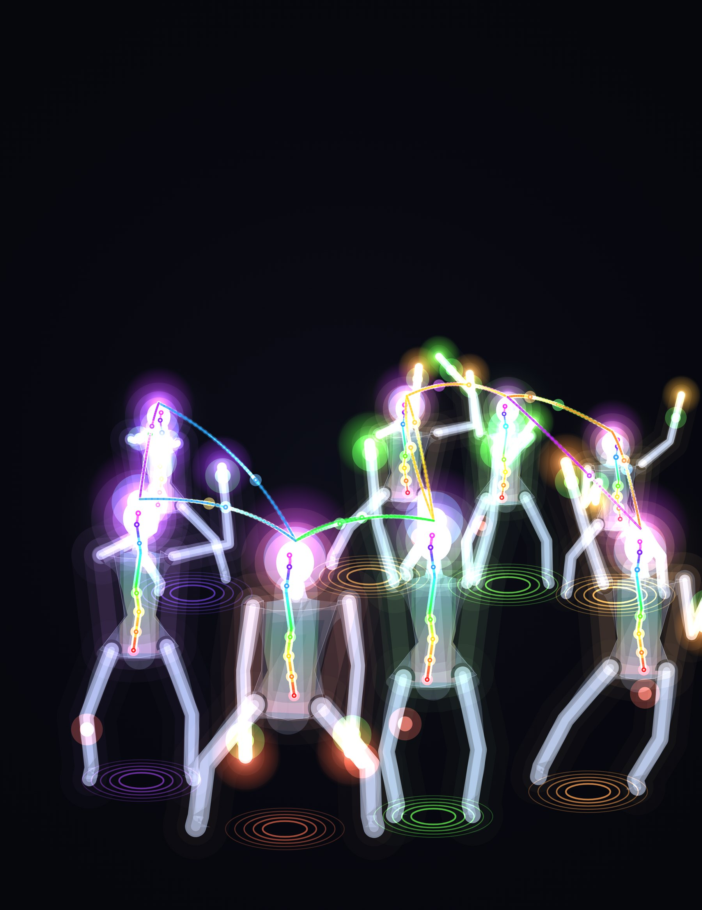
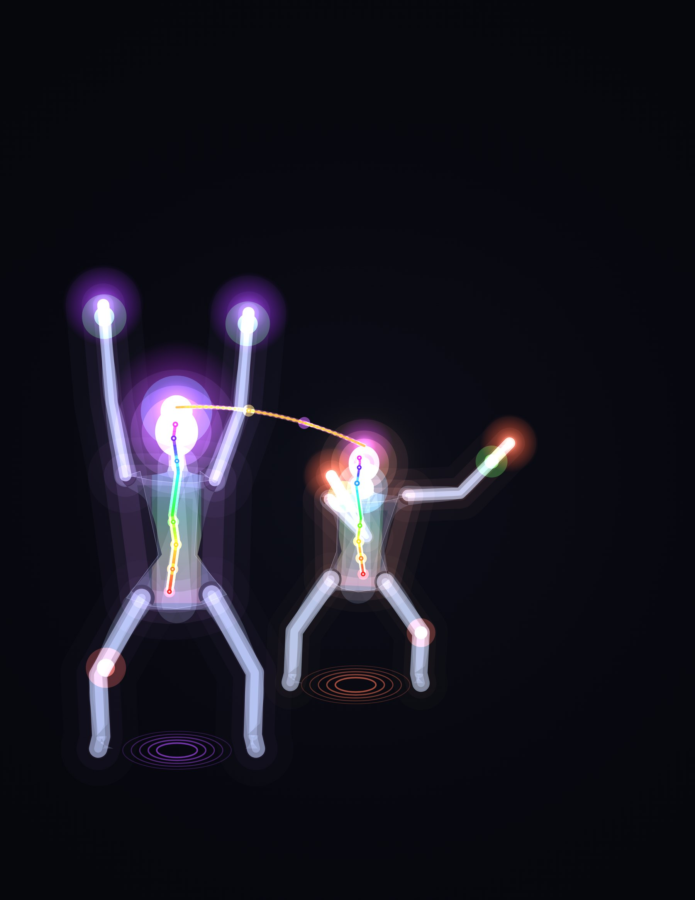

# Neural Dance — Under the Hood & Build History

<em>A participatory art mural</em> 
Timothy Joseph Murphy 
Seattle · November 2026 
<a href="https://tjm.art/neural-dance/">tjm.art/neural-dance</a>

A print edition of the engine room of the mural, prepared for the November 27 gathering. A guest sets a unique sticker on the painted floor, and a dancer appears there, moving with the music the phone hears in the room.

This book is the system behind that: how a body listens, how a pulse climbs a seven-node spine, how a sticker is found, and the real commit history of how it was built.

The [20-page PDF](neural-dance-book-20pp.pdf) is a compressed copy of the spiral-bound book.

## About this edition

This is the text of the book finished on November 23, 2026. It covers the mural engine through `2b96ea6` (PR #144), Monday, November 23, 2026, 6:30 PM PT. Stamp commits that only marked a live build are omitted, as they were in the print edition. Feature-branch work underneath these merges brought the graph to 382 commits at the time; the 145 entries below are the spine of the show.

A few lines in the print edition are dated, and they are marked in place:

- The title page named an “Open-Source Release” at [`github.com/timothyjosephmurphy/neural-dance-engine`](https://github.com/timothyjosephmurphy/neural-dance-engine), with 145 substantive commits (`2245a6c` → `2b96ea6`, PR #144), from Friday, November 6, 2026, 2:48 PM PT through Monday, November 23, 2026, 6:30 PM PT. This repository is that public open-source release under the [MIT License](../../LICENSE) (see also [neural-dance/LICENSE](../../neural-dance/LICENSE)). The public 3D gallery, including the Kinoteka Neural Dance annex, is [`timothyjosephmurphy/gallery-source`](https://github.com/timothyjosephmurphy/gallery-source).
- The live production build has moved on. As of the [repository README](../../README.md), the show on the wall is main `0f9f9e3` (PR #149, November 24, 2026). That later work adds the Paradise Dystopia crowd show (`/neural-dance/show/` and `/demo/`), scan and flash fixes from PRs #145–#147, and the request, prop, and hot-update work in PR #149. The pages below stop at PR #144.

## Contents

**The book**

- Inside title
- Contents

**Plates**

- [I. The Seven-Node Spine](#i-the-seven-node-spine)
- [II. Heart Branch & Crown Burst](#ii-heart-branch--crown-burst)
- [III. Collective Floor](#iii-collective-floor)
- [IV. Band Hues & Stomp Ripples](#iv-band-hues--stomp-ripples)
- [V. Encore on the Floor](#v-encore-on-the-floor)

**The engine**

- [How the pieces connect](#how-the-pieces-connect)
- [How the dancers and dancing work](#how-the-dancers-and-dancing-work)
- [How alignment and sticker detection work](#how-alignment-and-sticker-detection-work)
- [Build history](#build-history)

## I. The Seven-Node Spine

I. The Seven-Node Spine — energy climbs the leg chain and lights seven chakras, root to crown.

## How the pieces connect

Seven subsystems share one phone, one projector, and the painted wall. The names below are the real modules in the source, written so someone holding this page can follow the path from a sticker on the floor to a pulse crossing the room.

## What each piece does

### Audio and beat listening

`beat-clock.js · silence-gate.js · src/band-onsets.js · src/global-tempo.js · src/listen-pattern.js · src/beat-entrain.js · src/song-tempo-lock.js · nn/nn-listen.js · src/nn-drive.js · src/melody-pad.js · src/song-energy.js · src/breakdown-detect.js`

The phone microphone listens to the music in the room. A silence gate measures the true noise floor and keeps ordinary room sound from stirring the dancers; when the room is quiet, the figures go still. When a song is playing, the signal is split into kick, bass, snare, and hi-hat bands. Each band has its own onset detector, so a kick can lock beat one while the hats shimmer on a faster subdivision. A global tempo lock holds the song’s pulse through small gaps, and a pattern learner reads meter, downbeat, groove, and phrase. When the neural beat tracker is confident, it drives the steps; when it is not, the onset clock keeps time. Between songs the floor can rest, and a gap scan can look for new stickers.

### Camera calibration and homography

`camera-markers.js · src/align-anchors.js · src/align-capture.js · src/align-refine.js · src/align-precision.js · src/quad-lock.js · src/perspective-floor.js · src/painting-frame.js · src/latency-code.js`

The phone camera looks at the mural from an angle, often from a shelf or a tripod off to one side. Four corners of the painted dance floor — found from a projector alignment pattern, green calibration marks, or a hand-set quad — build a homography that maps the camera’s view onto the stage the projector sees. A refine pass tightens the fit; a precision grid and structured light can verify it. The painting frame is locked to the mat so a dancer lands on the floor, and a perspective floor keeps the feet planted in the mural’s own space. Once that map is true, a sticker the camera finds is the same point the projector will light.

### Sticker vision and shape gating

`camera-markers.js · src/white-stickers.js · src/painting-diff.js · src/painting-session.js · src/sticker-flash.js · src/sticker-verify.js · src/sticker-pose.js · src/scan-session.js · src/blank-scan.js · src/projector-hold.js`

Each guest chooses a unique hand-cut sticker and sets it on the painted floor. To see it clearly, the projector holds a clean white field, the camera stores that capture, and the next scan is compared against it — a before-and-after diff in color and brightness, so only something newly placed will spawn a dancer. The detector then asks whether the shape is really a figure: solidity (how fully the blob fills its outline), circularity (to turn away sun discs and even ovals), and intersection-over-union against dancer-shaped templates. Lighting drift and sun bloom are ignored. A slender, irregular silhouette can pass. A bright patch on the wall is left alone. A confirmed sticker can even keep the pose it was scanned from.

### Person detection and the auto-scan loop

`src/person-occlusion.js · src/visit-scan.js · live-show.js · src/song-gap-scan.js · src/ok-hand-scan.js`

When a visitor steps in front of the mural, the camera sees a tall, connected region and pauses sticker scanning so a hand, a sleeve, or a shadow is not mistaken for a dancer. The visit stays open while they place their sticker. After they leave, the floor has to be clear for a short settle — about a second and a half — and then one automatic scan runs. The loop will not scan while someone is still in the frame, and a visit fires only once. A quiet gap between songs can also start a scan, and an OK-hand close-up can ask for one.

### Dancer kinematics and the chakra wave engine

`src/skeleton-dancer.js · src/vibrating-string.js · src/crown-pulse.js · src/leg-ik.js · src/inner-bones.js · src/body-shell.js · src/footwork-steps.js · src/rave-moves.js · src/energy-motion.js · src/head-look.js · src/pad-arms.js · src/skeleton-motion.js`

Each sticker grows an articulated dancer: hip–knee–ankle and shoulder–elbow–wrist, with two-bone inverse kinematics, weight shifts, and planted footwork on the beat. Energy starts in the legs. A pulse climbs the leg chain to the sacrum, the root of the spine, and then travels a seven-node sine wave up the chakra line — root, sacral, solar plexus, heart, throat, third eye, and crown — colored red through violet. When the pulse reaches the heart, it branches through the shoulders and out the hands. When it reaches the crown, a burst leaves the head and shoots across the dance floor toward someone else, entering at their crown and lighting each node on the way down.

### Collective floor patterns and the projection renderer

`src/peak-network.js · src/link-radius.js · src/pulse-visibility.js · src/water-ripple.js · src/water-ripple-gpu.js · src/dancer-hue.js · wave-ring.js · src/silhouette-dance.js · src/show-arc.js · src/neural_dance.cpp`

A dancer sends a pulse only at peak energy. In a sustained peak the send can fan out to several nearby partners; relays travel a couple of hops and then rest, so the network breathes with the music. The link radius follows how spread out the floor is, so energy can travel a crowded field without wiring everyone to everyone. Across many dancers these beams, and the water ripples that fire on each stomp, form living patterns — the visible trace of people connecting on the dance floor. The projector paints all of it onto the physical mural: a see-through body so the chakra line stays visible, and a tint that follows the band each dancer moves to.

### Cloudflare Worker and live-show sync

`worker/index.mjs · live-show.js · scripts/build-pages.mjs · src/show-commands.js`

A Cloudflare Worker serves the show at tjm.art/neural-dance/. Pages and scripts are sent so a phone reload always picks up the current build. The live page keeps the projector view and the camera view in register, runs alignment and scans, and holds the floor state — who is on the mural, where the stickers landed, and the stills from the last scan — so the projection and the room stay one piece. That is the same software guests will find in the public repository, github.com/timothyjosephmurphy/neural-dance-engine.

*Note (November 24, 2026): the source is open under the [MIT License](../../LICENSE) at [`timothyjosephmurphy/neural-dance-engine`](https://github.com/timothyjosephmurphy/neural-dance-engine). The public gallery source, including the Kinoteka annex, is [`timothyjosephmurphy/gallery-source`](https://github.com/timothyjosephmurphy/gallery-source).*

## II. Heart Branch & Crown Burst

II. Heart Branch & Crown Burst — at the heart the pulse goes out through the hands; at the crown it crosses the floor.

## How the dancers and dancing work

Each sticker on the floor becomes a body that can listen, plant its feet, and send energy through a seven-node spine. This is the path from a kick in the room to a burst that can reach someone else.

*Live-simulation dancers in mid-phrase: energy climbs the leg chain, lights the seven-node spine, branches from the heart through the hands, and leaves as a crown burst that enters a neighboring dancer and lights each node on the way down.*

### Listening to the room

`beat-clock.js · silence-gate.js · src/band-onsets.js · src/global-tempo.js · src/listen-pattern.js · nn/nn-listen.js · src/nn-drive.js · src/song-energy.js · src/breakdown-detect.js · src/beat-entrain.js`

The phone microphone is the show's ear. A silence gate watches the true noise floor — the quiet percentile of recent level, measured only while the gate is closed, so the floor stays the quiet of the room. Near that floor, auto-gain stays at 1, and ordinary chatter leaves the dancers still. When the room is quiet, the figures go still.

When music is present, the live spectrum is split into four detection bands: kick (about 35–90 Hz), bass (190–450 Hz, a little higher on a phone mic so the low end still reads), mid and snare (480–4500 Hz), and hi-hat (5000–14000 Hz). Each band has its own SuperFlux-style onset detector: a rise over the previous frame, an adaptive threshold over about a second and a half, and a short refractory so a held note fires once. A small, calibrated lag is subtracted so the onset is timed to the hit, not to the analysis window. Kick dancers lock to the kick, bass dancers to the bass line, mid dancers to snare and vocals, and hat dancers to the hats.

Those onsets feed a global tempo lock. Every quarter second the engine autocorrelates the last six seconds of onset strength, prefers a tempo around 120 BPM in a 70–180 range, and locks once a couple of seconds of estimates agree. After that, a new tempo has to hold for about four seconds before the lock moves; a phase-locked loop keeps the beat phase on the onsets. On top of that, a pattern learner finds the smallest repeating step (the tatum), chooses a cycle from 2 to 32 steps so odd and additive meters can live, and builds a per-band template of when hits usually fall — including swing and push-and-pull. Positions the template trusts can fire on their predicted time, a little ahead of the ear.

A neural beat tracker can take the wheel once its confidence stays high for about a second and a half. Kick steps on the beat, bass often on a slower ratio, hats on a faster one, with downbeats accented. When that confidence drops, the onset clock and the pattern tracker keep time, and a short handoff window prevents a double-step. Song energy and a breakdown detector watch builds and drops, so the floor can lean into a peak and ease through a break. Between songs the figures rest, and a gap scan can look for new stickers.

### From sticker to articulated skeleton

`src/skeleton-dancer.js · src/leg-ik.js · src/footwork-steps.js · src/rave-moves.js · src/pad-arms.js · src/head-look.js · src/energy-motion.js · src/body-shell.js · src/dancer-hue.js · src/perspective-floor.js · src/sticker-pose.js`

Each confirmed sticker has a home on the perspective floor. The dancer stands planted there, leashed so travel stays near the sticker — about a tenth of the stage. The body is an articulated skeleton: hip–knee–ankle and shoulder–elbow–wrist, solved with two-bone inverse kinematics. The mid-joint bends toward a forward pole, the way the toes or the palm face, and a soft limit keeps a knee from locking straight. Bone lengths stay rigid, in human proportion (upper arm, forearm, and hand at 0.19, 0.16, and 0.11 of height).

Weight shifts foot to foot on the beat, with a short double-support after each plant. Footwork is a library of real steps — step-touch, grapevine, box, rock, kick-ball-change, T-step, running man, chasse — chosen per dancer and switched only on phrase boundaries, so a planted foot stays put mid-support. A tap puts a toe down with no weight; the stance foot does not change. Rave and club phrasing layers on top: two-step and jacking as a base, body waves when pads and melody swell, heel-toe and running-man when kick and hats are both up, and a kick-and-stomp accent at high activation or on a drop. Arms reach from melody and pad energy; at rest they hang softly, shoulders over the hips. The head glances and tilts on a slow phrase, up to about thirty degrees of yaw when the dancer is fully on.

Each dancer is tinted by the band it serves: warm red and orange for kick and bass, green and yellow for snare and mid, blue and violet for the hats, with a little per-person variation inside the family. The chakra string keeps its own red-to-violet order, independent of that tint.

### The chakra sine-wave engine

`src/vibrating-string.js · src/skeleton-dancer.js · src/body-shell.js · src/inner-bones.js · src/pulse-visibility.js`

Energy starts in the legs. A pulse climbs the leg chain — foot to knee to groin — and arrives at the sacrum, the root of the spine. From there a vibrating string runs only from root to crown, a traveling sine with seven lightly pinned nodes: root (red), sacral (orange), solar (gold), heart (green), throat (blue), third eye (indigo), and crown (violet). The wave is a smooth traveling sine; a light pin at each bead (a weight of 0.28) keeps the nodes readable at any tempo, without freezing the line into a hard standing grid. Amplitude follows the band level, and the visible rate is scaled down so even a hat dancer shimmers at a pace the eye can follow.

The body is drawn as a translucent shell with visible inner bones, so the chakra line stays clear through the figure. The string stays inside the head at the crown. It runs only along that root-to-crown span, and the crown, heart, and root beads ride the string and pulse with the beat.

### Heart branch, crown burst, and the collective floor

`src/crown-pulse.js · src/peak-network.js · src/link-radius.js · src/water-ripple.js · src/water-ripple-gpu.js · src/show-arc.js · src/pulse-visibility.js`

When a traveling pulse reaches the heart — about two-fifths of the way up the string — it branches through both shoulders and out the arms to the hands, with a small decaying lift at the elbows. When it arrives at the crown at peak energy, a send leaves the head and flies across the floor to another dancer, entering at their crown and lighting each node on the way down. A normal send goes to the nearest partner. In a sustained peak, when activation is held high, the climb shortens (about half a second instead of about a second) and the send can fan out to several nearby partners, up to three. Relays travel at most two hops, then a rest of about 1.6 seconds, so the network breathes with the music. Pulses already in flight can still arrive during rest, gently, up to a cap.

The link radius follows how spread out the floor is: about 1.3 times the 75th-percentile nearest-neighbor distance, never below the original 82 stage units, and capped so a sparse floor does not wire everyone to everyone. Underfoot, a height-field ripple fires only on each dancer's own stomp or foot-plant, tinted with that dancer's hue; overlapping waves mix additively and make patterns the mural can hold when the floor is full. That is the visible trace of people connecting on the dance floor.

## III. Collective Floor

III. Collective Floor — pulses hop from dancer to dancer, and the painted floor fills with living patterns.

## How alignment and sticker detection work

The phone looks at the mural from an angle. The projector paints dancers onto the same wall. Getting a sticker under a foot, and only a sticker, is a geometry problem and a vision problem, solved in that order.

*Alignment and the white-scan pipeline: off-axis camera, four-corner homography, the guest steps clear, a smooth white hold and exposure settle, a gain-matched reference diff and silhouette IoU gate, then a latched dancer on the mural.*

### Camera-to-projector alignment and homography

`camera-markers.js · src/align-anchors.js · src/align-capture.js · src/align-refine.js · src/align-precision.js · src/painting-frame.js · src/perspective-floor.js · src/quad-lock.js · live-show.js`

The phone usually sits off to one side — on a shelf or a tripod — so the camera sees the painted floor as a trapezoid. Align holds a sequence of projected patterns long enough for the camera to actually see them, about two and a half seconds a phase: a black field, a white field, green calibration circles, a grid, and, for a precision pass, structured light (Auto Align). Four corners of the dance floor — from Auto Align, from those green anchors, from the dark painting frame on the mat, or from a hand-dragged quad — become a two-dimensional projective homography: an eight-degree-of-freedom map that takes any camera pixel to a point on the projector's stage.

The green circles sit inset on the floor; pink handles snap onto them, and the engine extends that inset map out to the true stage corners. If a noisy circle would send the top edge flying off the wall, a safer affine fallback keeps the floor on the painting. A refine pass and a precision check — grid fit, structured light, a crosshair or a walk check — can tighten and verify the fit. A perspective floor then warps what is drawn so feet stay planted in the mural's own space. Once that map is true, a sticker the camera finds is the same point the projector will light.

### Learning the bare painting and holding white light

`src/sticker-flash.js · src/projector-hold.js · src/painting-session.js · src/blank-scan.js`

The mural is a painting, and the show itself is color and motion. A scan taken during a dance would see projected limbs as if they were stickers. So a scan fades the live image into a clean white field (about 300 milliseconds up), holds full white, and waits for the phone's auto-exposure and white balance to settle — at least 600 milliseconds, up to about 1.8 seconds, until the median brightness stays still for three frames. Only at that hold is a frame captured; the fade itself is never used as a latch.

A first learn (Re-learn) stacks about twelve person-free white frames and keeps the median as the bare-painting reference: the wall as it was, before any guest placed a sticker. Later scans compare against that reference, or against the last good capture, so only something newly placed will count.

### Person detection and the single-scan visit loop

`src/person-occlusion.js · src/visit-scan.js · live-show.js · src/song-gap-scan.js · src/ok-hand-scan.js`

While the show runs, the camera also watches for a visitor. A person is a tall, connected region that covers a meaningful share of the frame — by default at least about a fifth of it, or a large dark occluder of about eight percent — with body and skin cues and a motion grid on a downsampled background. Four frames of presence open a visit; eight clear frames, and a floor that has been still, start the exit. Detection pauses for the whole visit, so a hand, a sleeve, or a shadow cannot spawn a dancer.

After the guest places a sticker and leaves, the floor has to be clear for about 1.5 seconds, and coverage has to fall back under about four percent of the frame. Then one automatic scan runs. A visit fires only once, with a few seconds of cooldown so the white field fading out cannot count as another arrival. A quiet gap between songs can also start a scan, and an OK-hand close-up can ask for one.

### Before-and-after diffing and dancer-shape gating

`src/painting-diff.js · src/white-stickers.js · src/sticker-verify.js · src/sticker-pose.js · src/scan-session.js`

The new white frame is warped through the painting-frame quad onto a rectified grid, up to about 960×720 so a limb stays a few pixels wide. Before the diff, the capture is gain-matched to the reference — midtone medians per red, green, and blue — so a sunset shift or a small exposure change is evened out. A clipped sun bloom is counted only when the change is chromatic; a pure brightness flare stays quiet.

What remains is a set of changed blobs, kept only if they are the right size and fill (large enough to be a figure, small enough to be a sticker, inside the inset floor). Each blob is measured for solidity (how fully it fills its outline), circularity (4π × area ÷ perimeter²), aspect ratio, and hole fraction, then compared by intersection-over-union to a bank of 16×16 dancer-silhouette templates, including left-right flips. In tests from 480p through 1080p, real dancer stickers land near solidity 0.92, IoU about 0.64–0.73, and circularity about 0.49–0.53.

The gate asks for an IoU of at least 0.30, circularity below 0.80, solidity below 0.93, and an aspect between 0.16 and 1.8. A high-solidity blob that is also very round, or that misses the silhouette templates, is treated as an oval or a disc and left on the wall. A confirmed sticker is latched at that floor point, can keep the pose it was scanned from, and a dancer appears there, already standing on its home.

## IV. Band Hues & Stomp Ripples

IV. Band Hues & Stomp Ripples — each figure tints to the band it dances to; stomps leave overlapping rings of light.

## Build history

Every substantive first-parent commit on `main` is here, in the order it landed, with a plain-language line for what it actually did (routine live-build stamp commits are omitted). Feature-branch work underneath these merges brings the full graph to 382 commits; the 145 below are the spine of the show.

### Friday, November 6, 2026

3 commits on main · Pacific Time

The first source lands, and a Worker is ready to serve the show.

- `2245a6c` · 2:48p — Add the Neural Dance source and an upload-ready Worker.
- `d9152ba` · 3:20p — Port silhouette dance and person-occlusion sticker pause.
- `d84a1eb` · 5:03p — Make person-pause less sensitive, and reload the live page on deploy.

### Monday, November 9, 2026

76 commits on main · Pacific Time

One long studio day: alignment, sticker latch, the chakra string, ripples, and the first listen engine — 114 commits, many shipped live the same hour.

**Late morning — first scans and alignment** · 8

- `edddf58` · 10:06a — Scan stickers on blank frames, and throb the silhouette fill.
- `0ff7636` · 10:26a — Draw waveform outlines as additive energy blooms.
- `741a85f` · 10:56a — Lock alignment to the bright screen, and keep live taps from zooming.
- `baee453` · 11:15a — Show alignment marks on the projector, and detect dark stickers before a finished align.
- `762aa27` · 11:47a — Stop Align from hanging, and keep projector chrome off the camera.
- `46fb53f` · 12:08p — Latch only new stickers that repeat on the matching flash.
- `5bfcdbb` · 12:12p — Restore the sticker silhouette when the wall is not aligned yet.
- `96b8cc4` · 12:37p — Stop projected light from growing sticker silhouettes (#2)

**Afternoon — reliability, latch, and silhouettes** · 19

- `5ecc0ff` · 1:01p — Fix the studio link for the live show (#3)
- `6107819` · 1:39p — Harden live-show reliability for the November exhibition (#4)
- `de16183` · 1:49p — Fix the latency test, refuse bad align quads, and lengthen the blank hold (#5)
- `551d1ee` · 2:04p — Harden latency decode, soften blank verify, and add a gray scan (#6)
- `a96af46` · 2:08p — Show the build SHA on the live controls and viewer (#7)
- `8da4792` · 2:16p — Rebuild the latency code with two-row fat cells and hidden chrome (#8)
- `1e34421` · 2:18p — Report gray scan mode in live telemetry (#9)
- `ba093a6` · 2:29p — Restore continuous sticker detection and fix the projector build stamp (#10)
- `7001d11` · 2:32p — Default the blank flash off, and keep flash control off the live floor (#11)
- `aae7e41` · 2:49p — Latch stickers with one-second persistence, refuse bad aligns, and fix person-pause pairing (#12)
- `ebf3e94` · 3:09p — Get stickers to latch and stay, with silhouettes in stage pixels (#13)
- `54bf265` · 3:22p — Warn on off-align chrome, fire person pause on the rig, veto projected blooms, and reset stale stickers on re-align (#14)
- `73ce6d8` · 3:33p — Let a hand-set quad own the mapping, without sticker wipes from the border lock (#15)
- `f4df3f5` · 3:35p — Default Light mode to silhouette and remember the choice (#16)
- `2b62353` · 3:46p — Anchor the camera map on the green circles, with pink handles that snap to them (#17)
- `1238b40` · 3:56p — Refine alignment, sharpen silhouettes, flash on Scan, and keep sensitivity in a safe range (#18)
- `9805fe9` · 4:01p — Detect the lower-midline sticker with a regional floor instead of the stage median (#19)
- `ac7ca92` · 4:10p — Center silhouettes on their sticker, size rehearsal dancers to the sticker, and refine alignment on nine points (#20)
- `a935775` · 4:16p — Flash white on Scan stickers, hide live chrome, and clean up the scan path (#21)

**Early evening — the string, ripples, and listen bands** · 20

- `80ecd8d` · 4:21p — Draw a rainbow vibrating string through each dancer (#22)
- `bea6737` · 4:27p — Send water ripples across the floor from dancer impulses (#23)
- `1f453d9` · 4:49p — Hotfix sim latch, Scan fade, lit-room Align, and ambient person detection (#24)
- `dace406` · 4:55p — Bring in full shadows, chakras, hue ripples, and lit-room refine (#25)
- `7e86be6` · 5:14p — Keep silhouettes sticker-sized, calm the body, run the string root to crown, and settle ripples (#26)
- `e1e751a` · 5:18p — Tint ripples per dancer, drop the dark halo, and reduce blotch (#27)
- `16a0134` · 5:20p — Give the rehearsal dancers lithe, unique silhouettes (#28)
- `a935dd2` · 5:27p — Cast shadow silhouettes, bow with the weight shift, and pulse on the foot strike (#29)
- `050cfbd` · 5:32p — Let an OK-hand close-up trigger Scan stickers (#30)
- `66d1597` · 5:52p — Dim the glow, lock band hues to the beat, and drive energy ripples (#31)
- `513af6a` · 6:01p — Keep idle motion, auto-recover Listen, and smooth the ripple field (#32)
- `0f2ba44` · 6:12p — Make Align refine coherently, drop sticky last-quad refusals, and accept a 4:3 aspect (#33)
- `da32850` · 6:13p — Untrack an accidental node_modules symlink (#34)
- `bb7fe39` · 6:38p — Clamp rehearsal dancer size and guard against far-camera crashes (#35)
- `eca5b0d` · 6:46p — Run ripples on the GPU, articulate seven-chakra dancers, and align from farther away (#36)
- `ed3e18a` · 6:54p — Shrink the dancers, spread the layout, and keep corner insets faithful (#37)
- `053d4d5` · 7:06p — Give each listen band its own onset timing so kick, bass, mid, and hat lock to their own part (#39)
- `261d77d` · 7:10p — Pulse the string from the side rehearsal, arc the legs through the groin, and plant the stance foot (#38)
- `29a48ac` · 7:22p — Rewire tuning controls, stream listen telemetry, and fix the hat band (#40)
- `0057227` · 7:27p — Stop all dancer movement in true silence (#41)

**Night — pulses, volume, and a neural beat grid** · 29

- `58a98ce` · 7:40p — Add pattern learning for meter, groove, and cross-band tempo, flagged off at first (#43)
- `8a65026` · 7:48p — Port arm lift, 3D shading, a softer gait, and hue, bloom, and aura from the side rehearsal (#45)
- `e7b8111` · 7:56p — Lock a robust global song tempo, couple the band tempi, and turn pattern listening on by default (#46)
- `7fe9045` · 7:59p — Let the pulse-link radius follow the spread layout so energy can travel again (#48)
- `f2a3a3f` · 8:01p — Add a sound-responsive rehearsal simulation (#49)
- `f4012a2` · 8:06p — Vary arm lifts per dancer, activate pulses individually, and widen the stance range (#50)
- `edd1ed1` · 8:11p — Send pulses head to head with a cascade cap, so silent pulse loops cannot run on (#51)
- `d6f34c4` · 8:12p — Lay out the rehearsal page with under-dancer meters and live-show listen gain (#52)
- `338870d` · 8:16p — Add level-adaptive band floors and a recommended band sensitivity (#53)
- `58bf6b0` · 8:18p — Find tiny far-camera stickers and merge ones that split apart (#54)
- `414018c` · 8:20p — Record where and when the camera quad was set (#55)
- `f99ac6a` · 8:29p — Accept the wide iPhone stage quad, and warn when refine says Align is off (#56)
- `da0c1c9` · 8:30p — Let bass onsets fire on quiet phone microphones (#57)
- `b65492c` · 8:39p — Port the remaining side-rehearsal motion and per-dancer received energy (#58)
- `1710e55` · 8:41p — Stop pulses at the live head as pinpoints, with the trail collapsing on impact (#59)
- `154eaa1` · 8:45p — Add an adaptive silence gate that settles the floor to stillness (#60)
- `a68a886` · 8:48p — Document the November 9 evening history (PRs #46–#59) (#61)
- `332c2b5` · 8:52p — Stop the white alignment grid from reading as teal (#62)
- `2e05179` · 8:58p — Let pulses float as free particles that home on the live target head (#63)
- `8cf81e5` · 9:00p — Add 3D volume, body weight, and spring physics (#64)
- `a8d2e3a` · 9:06p — Auto-resume after a screen lock, restore WebGL, and bound audio and per-dancer state (#65)
- `ae6b7fc` · 9:11p — Reconnect the phone after a deploy or a stale publisher lock (#66)
- `e67d964` · 9:15p — Keep the projector running through bad frames, heal 3D motion state, and re-acquire a dropped mic (#67)
- `843ebec` · 9:17p — Reject projected ripples as stickers, and expire unconfirmed dancers (#69)
- `c10d8a5` · 9:21p — Hold live auto-reload during Align, sticker scans, and the alignment pattern (#70)
- `67e029f` · 9:31p — Document the November 9 late-evening history (PRs #56–#70).
- `7b8a013` · 9:36p — Add an isolated neural beat tracker, hold tempo through silence, and issue no beats when the room is quiet (#68)
- `d00b1a9` · 9:45p — Add 3D figure-eights, a rest stance, full live volume, and foot traction (#72)
- `e363623` · 10:17p — Let the neural beat tracker drive the dancers when it is confident, with the pattern tracker as fallback (#73)

### Tuesday, November 10, 2026

24 commits on main · Pacific Time

Listening gets a tempo lock and a neural beat tracker. Dancers gain weight, planted feet, and a floor that ripples on the stomp.

- `a06aaa9` · 10:07a — Keep a latched sticker from vanishing when its own dancer hides it (#74)
- `130e5bb` · 10:25a — Cap stance width so feet stay within two shoulder widths, with a horse stance only at peak (#75)
- `084219c` · 10:29a — Keep the listen gate from locking shut during music (#76)
- `9e7db60` · 10:54a — Hold Align until it is captured, then check stickers and correct drift (#78)
- `dea5a6f` · 10:59a — Forward sticker-check, drift, and camera-lock telemetry (#79)
- `52064c5` · 11:10a — Ground the dancers: no sliding, a rest stance, forward knees, bottom-up support, and a quiet idle groove (#80)
- `3fb90d6` · 11:18a — Add a hue-spread control for ripple color, hue jitter, and string tint (#81)
- `767afc6` · 11:29a — Draw a finer chakra line, and treat bloom zero as no glow (#82)
- `bbc0ccc` · 11:39a — Set calmer default ripple and hue-spread values, with saved values still winning (#83)
- `279f242` · 12:00p — Lock feet to the floor except when stepping, soften the weight shift, and anchor chakras on the final body (#84)
- `591d6b6` · 12:15p — Stand the rest torso straight and tall, with shoulders over the hips (#85)
- `a67099a` · 12:37p — Lock the stage floor so it cannot stay a calibration fill (#89)
- `2d003b6` · 12:45p — Lift red and green pulse luminance so they read on the projector (#87)
- `56db6fe` · 12:52p — Scan for stickers between songs (#86)
- `0b1b237` · 1:07p — Port the transparent body shell and melody/pad arms into the live show (#77)
- `d634f3a` · 1:42p — Catch all three stickers on the white scan, keep confirmed stickers across gap scans, and re-anchor dancers after Align (#90)
- `846131e` · 2:32p — Light a see-through 3D body with pulses, steady the insets, and draw every dancer (#94)
- `b4ad499` · 2:42p — Fire floor ripples only on each dancer's stomps (#92)
- `f9255e5` · 2:52p — Drive the arms more strongly from pads and melody (#93)
- `f736093` · 3:36p — Add a perspective floor, visible stomp ripples, and constant insets (#95)
- `89acf2d` · 8:29p — Place side hip joints and a pelvic crossbar on 7.5-head proportions (#96)
- `a4c71c4` · 9:30p — Add a rave and club step repertoire (#97)
- `7d32719` · 11:07p — Draw visible inner bones (#98)
- `0830264` · 11:34p — Keep the see-through body at rest in the live show (#99)

### Wednesday, November 11, 2026

13 commits on main · Pacific Time

Heads turn, pulses fire at peak, the painting becomes the stage, and the live show learns the rehearsal's groove.

- `2ed1636` · 12:42a — Add head turns, wider ribs, soled feet, and forward knees (#100)
- `82640fd` · 2:28p — Fix a headless shoulder-shrug on live dancers (#101)
- `38b80b1` · 3:22p — Send pulses only at peak, hold the peak for five seconds, and keep dancing low through the cooldown (#102)
- `ea32b32` · 3:39p — Tighten projector alignment with a grid fit, structured light, and verification (#103)
- `58ead56` · 4:14p — Wait for a person-free floor before a sticker rescan, with person-pause on by default (#104)
- `be6a707` · 4:30p — Let Seed add twenty-four rehearsal dancers per press, with see-through bodies (#105)
- `0d5d355` · 4:47p — Return each dancer to the pose of the sticker it was scanned from (#106)
- `3948afb` · 5:37p — Treat the painting as the stage: frame to corners, a surface mask, and white stickers (#107)
- `2bf5694` · 7:08p — Entrain stomps to predicted beats, boost on-beat steps, and reach the arms forward (#108)
- `8f427f6` · 7:31p — Drive hips from the bass groove, arms from sustained melody, and claps from the backbeat (#109)
- `59e4383` · 7:57p — Bring rave steps, head turns, inner bones, and a head-confined string from rehearsal into the live show (#112)
- `4be7d9a` · 9:52p — Smooth the chest outline when dancers turn sideways (#110)
- `14630c7` · 9:52p — Straighten the torso profile and slim the chest (#111)

### Thursday, November 12, 2026

6 commits on main · Pacific Time

The room learns meter and phrase, and the feet start stepping on the beat.

- `489f946` · 3:13a — Learn beat patterns: meter, downbeat, groove, and phrases (#114)
- `4f51571` · 12:16p — Add planted footwork steps that land on the beat (#115)
- `4c35654` · 12:27p — Add project documentation and ignore build output and fixtures (#116)
- `e173be6` · 12:37p — Add build-and-drop motion and a stronger breakdown detector (#113)
- `f1598ca` · 1:24p — Keep rehearsal arms and chakra waves on the body, and stop the frame hitches (#117)
- `fae4efa` · 2:33p — Keep the controls page responsive, including the painting buttons (#118)

### Tuesday, November 17, 2026

11 commits on main · Pacific Time

The painting frame stays on the mat, scans get honest, and the show's large functions are given names.

- `ec59bef` · 12:29a — Update the project map and rollback note to fae4efa (#121)
- `9446259` · 12:29a — Add crown pulse, bass buzz, show arc, and a tall stance for the morning rehearsal (#119)
- `bac5c87` · 12:30a — Redesign the Neural Dance controls page (#120)
- `0deb185` · 8:45a — Split the show test gate and drop redundant source checks (#122)
- `e40622b` · 9:18a — Share geometry math and fix the three failing show tests (#123)
- `b4fecde` · 9:23a — Fix live commands, bare-painting relearn, and manual corners (#124)
- `bb6ea89` · 9:36a — Keep the painting frame on the mat and find both white stickers (#125)
- `6442b87` · 10:20a — Hold the projector white on Re-learn, and clear one-shot buttons (#127)
- `ead99a0` · 10:44a — Lock dragged frame corners and stack the iPhone controls (#128)
- `019c932` · 11:26a — Latch stickers only on Scan, and map dancers through the pink quad (#129)
- `4122336` · 11:59a — Fix the sticker projection offset and calibrate from a dot grid (#130)

### Thursday, November 19, 2026

5 commits on main · Pacific Time

A cleanup week: one entry per page, the rehearsal sim shares the live pose, and preview params get their own room.

- `a88a6a1` · 8:30a — Split the show's large functions into named steps (#131)
- `3e2020d` · 8:45a — Add a rehearsal preview worker, a smoke gate, and a hot params file (#132)
- `af636ec` · 8:53a — Give each page one module entry and load the silence gate as a module (#133)
- `4e4e089` · 10:52a — Drive the rehearsal sim from the live pose (#134)
- `4e8e95e` · 5:36p — Add a rehearsal-only params room for preview tuning (#135)

### Monday, November 23, 2026

7 commits on main · Pacific Time

Show week. Painting stickers spawn dancers, visits fire a single scan, and PR #144 lands the empty-room, solidity, and full-detail fixes.

- `303e9e2` · 11:34a — Let painting stickers spawn dancers and correct the corner quad (#137)
- `33258c6` · 12:46p — Scan painting stickers only after a white hold, against the last capture (#138)
- `0f4e43e` · 1:01p — Stop the white scan from looping, and fade it on the projector (#139)
- `c270c95` · 1:13p — Ignore exposure drift when scanning stickers, and let a visit fire (#140)
- `833a2f8` · 3:12p — Reject sun bloom and lighting drift as painting stickers (#142)
- `7fc033a` · 5:04p — Keep painting scans, keystone frames, and slender stickers (#143)
- `2b96ea6` · 6:30p — Fix empty-room pause, sticker solidity, and full-detail scans (#144)

## V. Encore on the Floor

V. Encore on the Floor — a peak in the music, and the whole field fires at once.

## Back cover

A guest places a unique sticker on the painted dance floor, and a dancer appears there, moving with the music the room is already playing.

Pulses climb the legs, travel a seven-node wave up the spine, bloom through the hands at the heart, and leave the crown as a burst that can energize someone else.

When the floor is full, those pulses become the visible trace of people connecting.

tjm.art/neural-dance

Timothy Joseph Murphy

Seattle · November 2026
